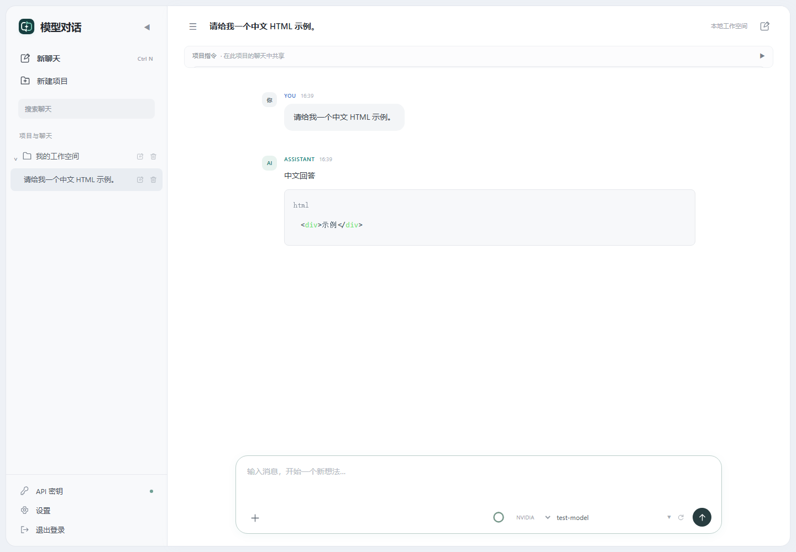

<div align="center">
  
  <h1>MultiChat · 模型对话</h1>
  <p><strong>多模型，一个安静的本地工作空间。</strong></p>
  <p>为 Windows 打造的多供应商 AI 对话客户端。连接自己的 API，按项目组织想法。</p>
  <p>
    <a href="https://github.com/Gongkddz/MultiChat/releases/latest"></a>
    <a href="LICENSE"></a>
    
    <a href="https://github.com/Gongkddz/MultiChat/actions/workflows/windows.yml"></a>
  </p>
  <p><a href="#下载与运行">下载运行</a> · <a href="#功能">功能</a> · <a href="#从源码运行">源码运行</a> · <a href="SECURITY.md">隐私与安全</a> · <a href="CHANGELOG.md">更新记录</a></p>
</div>



## 功能

| 工作空间 | 对话体验 | 模型与用量 |
| --- | --- | --- |
| 项目与会话管理 | 流式回复与思考折叠 | NVIDIA NIM / DeepSeek |
| 左上固定新聊天 | 编辑、重新生成、继续生成 | 完整模型列表与即时搜索 |
| 重命名与删除确认 | Markdown、代码高亮与复制 | 按供应商管理 API Key |
| JSON 记录导入导出 | 文本与图片附件 | 上下文圆环、缓存命中率、累计 tokens |

输入框右下角选择供应商和模型；点击模型显示完整列表，输入名称进行筛选。悬停上下文圆环可查看详情。

## 下载与运行

1. 前往 **[Releases 下载页](https://github.com/Gongkddz/MultiChat/releases/latest)**，下载 `MultiChat-v1.0.0-windows-x64.zip`。
2. **完整解压**到可写目录，双击 `NVIDIAChat.exe`。无需安装 Python，也无需管理员权限。
3. 首次登录选择 NVIDIA 或 DeepSeek，输入自己的 API Key。之后可从左侧“API 密钥”中管理连接。
4. 新建项目或聊天，在输入框右下选择模型，开始对话。

系统要求：Windows 10 / 11 x64、Microsoft Edge WebView2 Runtime 和 .NET Framework 4.8。下载版在 Windows 11 x64 验证；Windows 10 为兼容目标，未做独立实机验证。不提供 ARM64、32 位或 Android 构建。

- 缺少 WebView2 时，从 [Microsoft 官方页面](https://developer.microsoft.com/microsoft-edge/webview2/)安装 Evergreen Runtime，首次安装运行时需要联网。
- 界面资源不依赖 CDN；获取模型列表和生成回复需要联网及有效的供应商额度。API 费用由供应商收取，本项目不附赠密钥或额度。
- 便携包包含许可证文件与图标，请保留随附文件。程序数据保存在 Windows 用户目录中，不随 EXE 移动。
- `SHA256SUMS.txt` 提供校验。PowerShell 执行 `Get-FileHash .\MultiChat-v1.0.0-windows-x64.zip -Algorithm SHA256` 并比对。
- 当前下载包未进行代码签名，Windows 可能提示未知发布者。请核对仓库来源与校验值。

## 用量说明

上下文容量在“设置”中按**供应商 + 模型**填写，圆环显示文本估算的剩余比例；图片和未知容量不显示虚假的百分比。估算不预留下一次输出预算。

缓存命中率来自最近一次有 usage 数据的请求；累计 tokens 为当前对话中供应商已报告用量之和，包含重新生成。未报告的请求、旧记录和提前中断的未报告用量无法追溯。供应商未提供缓存字段时显示“未提供”。

## 数据与隐私

- 配置、聊天记录和 WebView 配置保存在 `%LOCALAPPDATA%/NVIDIAChat/`，不是仓库目录。
- **保存的 API Key 为本地明文配置**，不进入聊天导出文件。请保护个人 Windows 账户和备份。
- 发送消息后，历史消息、项目指令与附件内容会发送给选定供应商。本项目不提供中转服务。
- 服务仅监听 `127.0.0.1:8765`，此 Windows 开源版本不包含局域网自动发现或手机同步。
- 原有桌面版用户可继续读取同一数据目录，建议升级前导出聊天记录。

详见 [SECURITY.md](SECURITY.md)。

## 从源码运行

推荐 Python 3.12 x64，依赖使用锁文件固定版本。

```powershell
git clone https://github.com/Gongkddz/MultiChat.git
cd MultiChat
py -3.12 -m venv .venv
.venv\Scripts\python.exe -m pip install -r requirements.lock
.venv\Scripts\python.exe server.py
```

可通过环境变量 `MULTICHAT_DATA_DIR` 指定独立数据目录，适合开发和测试。

## 构建 Windows 版

```powershell
.\build_exe.bat
.venv\Scripts\python.exe scripts/package_release.py --version 1.0.0
```

构建脚本在项目 `.venv` 中安装 `requirements-dev.lock`，生成多尺寸 ICO，通过 PyInstaller 构建 `dist/NVIDIAChat.exe`，更新指向该 EXE 的现有用户快捷方式图标。它不会创建新快捷方式，也不会修改聊天记录。便携包和校验文件输出到 `release/`，源码树不保存 EXE 或分发 ZIP。

## 测试

```powershell
.venv\Scripts\python.exe -m pip install -r requirements-dev.lock
.venv\Scripts\python.exe scripts/run_tests.py
```

前端可选测试需 Node.js 24：执行 `npm ci --prefix tests/frontend`，启动 `python tests/preview_ui.py` 后在另一终端运行 `node tests/run_frontend.cjs`。预览数据全部为模拟内容，不读取真实密钥和对话，测试不消耗供应商额度。

## 已知边界

- 模型能力、可用性、输出上限和缓存字段由供应商决定；服务端主动断流仍可能发生。
- 文本附件会作为提示内容发送；目前不内置 PDF / Word 文本解析器。
- 本地 API 不是同一 Windows 用户下其他进程的身份隔离边界，请勿通过代理暴露端口。
- 端口 8765 被占用时无法启动第二个实例。

## 许可与致谢

原创代码和 Logo 使用 [MIT](LICENSE)。第三方代码保留各自许可证，详见 [THIRD_PARTY_NOTICES.md](THIRD_PARTY_NOTICES.md) 和 `third_party/`。本项目与 OpenAI Codex、NVIDIA 和 DeepSeek 均无隶属或背书关系。

感谢 [pywebview](https://github.com/r0x0r/pywebview)、[FastAPI](https://github.com/fastapi/fastapi)、[Uvicorn](https://github.com/encode/uvicorn)、[OpenAI Python SDK](https://github.com/openai/openai-python)、[Marked](https://github.com/markedjs/marked)、[highlight.js](https://github.com/highlightjs/highlight.js)、[DOMPurify](https://github.com/cure53/DOMPurify) 与 [PyInstaller](https://github.com/pyinstaller/pyinstaller)。
